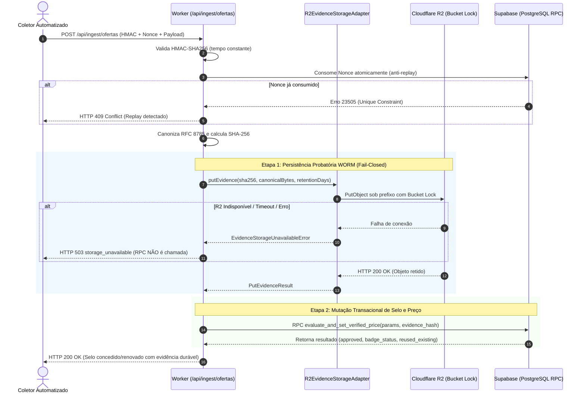

# Plano de Operação: Homologação de Armazenamento Remoto WORM (Cloudflare R2)

**Data:** 2026-10-17 12:15 (Atualizado: 2026-10-17 12:20)  
**Spec de referência:** `docs/specs/2026-10-16-2050-0021-pipeline-ofertas-worm-duravel.md` (AC-09 e AC-03)  
**Status:** Planejado (Aguardando autorização expressa do proprietário)  
**Natureza:** Desenho técnico prévio — **NÃO autoriza provisionamento, despesas, chamadas pagas de API ou deploy**.  
**Próxima entrega de produto:** Spec 0022 preservada no backlog.

---

## 1. Objetivo e Justificativa Técnica

A Spec 0021 está com validação local concluída (**8 PASS / AC-09 UNVERIFIABLE**). O critério `ofertas-pipeline/AC-09` e a proteção fail-closed (`AC-03`) exigem que o armazenamento probatório de ofertas possua **retenção imutável comprovada no provedor de nuvem** (WORM — _Write Once, Read Many_) antes da ativação do pipeline de concessão de selos.

Este plano estabelece a estratégia técnica para homologar o Cloudflare R2 com regras de **Bucket Lock (Bucket Retention Rules)** em um ambiente isolado, com custos estimados controlados e sem risco de contaminação de dados operacionais ou de produção.

---

## 2. Contrato Real de Bucket Locks no Cloudflare R2

Diferente do modelo S3 Object Lock baseado em cabeçalhos individuais por requisição (`x-amz-object-lock-*`), o **Cloudflare R2 implementa Bucket Locks via regras declarativas configuradas no nível do bucket ou prefixo**:

1. **Aplicação Declarativa por Prefixo:**
   - A retenção é governada por regra do bucket aplicada ao prefixo probatório (ex.: `evidencias/*`).
   - Qualquer objeto gravado sob o prefixo configurado herda automaticamente o período de retenção, sem necessidade ou presunção de suporte a cabeçalhos S3 Object Lock no `PutObject`.

2. **Delimitação da Garantia de Imutabilidade:**
   - **Garantia Efetiva:** Defesa em profundidade contra a credencial da aplicação coletora, falhas de software, concorrência descontrolada ou agentes externos comprometendo a chave do pipeline. Nenhum agente de aplicação consegue excluir ou sobrescrever um objeto sob retenção ativa.
   - **Limite de Governança:** O Cloudflare R2 permite que administradores com credenciais de gestão da conta modifiquem ou desativem regras de Bucket Lock pelo dashboard ou API administrativa. Portanto, a garantia técnica **restringe-se à blindagem contra a credencial da aplicação**, sem alegar imutabilidade absoluta ou irreversível contra o administrador da conta.

---

## 3. Arquitetura do Ambiente Isolado

Para evitar acoplamento ou riscos à infraestrutura de produção:

1. **Bucket Dedicado de Homologação:**
   - Nome canônico: `gradualinfo-evidencias-homologacao` (ou `gradualinfo-offers-evidence-stage`).
   - Finalidade exclusiva: testes de imutabilidade, ciclo de vida e retenção.
   - Proibido misturar com dados de produção ou com o bucket de mídia editorial (`SUPABASE_EDITORIAL_IMAGE_BUCKET`).

2. **Segregação de Variáveis e Secrets:**
   - Configuração local via `.dev.vars` / variáveis de ambiente de teste:
     - `R2_EVIDENCE_BUCKET=gradualinfo-evidencias-homologacao`
     - `R2_ACCOUNT_ID=<account-id-cloudflare>`
     - `R2_ACCESS_KEY_ID=<token-aplicacao-homologacao>`
     - `R2_SECRET_ACCESS_KEY=<secret-aplicacao-homologacao>`
   - Ou via Cloudflare Worker Binding direto:
     ```jsonc
     "r2_buckets": [
       {
         "binding": "EVIDENCE_BUCKET",
         "bucket_name": "gradualinfo-evidencias-homologacao"
       }
     ]
     ```

3. **Período de Retenção Sintética para Homologação:**
   - A política de produção da Spec 0021 exige 730 dias (dois anos) na camada quente.
   - No ambiente de homologação, para viabilizar validação de ciclo de vida e evitar retenção perpétua de dados de teste descartáveis, adota-se:
     - **Prefixo de Teste WORM Estrito (`evidencias-lock/*`):** Retenção curta configurada (ex.: 1 a 7 dias) para comprovar a recusa física de exclusão e permitir posterior limpeza programada.
     - **Prefixo Livre (`livre/*`):** Sem regra de Bucket Lock, utilizado para calibrar a contraprova de exclusão.

---

## 4. Permissões Efetivamente Disponíveis e Separação de Credenciais

No Cloudflare R2, tokens de API S3 oferecem permissões predefinidas por escopo (`Admin: Read & Write`, `Object: Read & Write`, `Object: Read Only`). Como o modelo S3 do R2 não possui granularidade fina para remover apenas a ação `DeleteObject` mantendo `PutObject` dentro da mesma permissão de escrita, **a proteção física contra exclusão decorre obrigatoriamente da regra de Bucket Lock aplicada no bucket, e não da ausência de permissão na credencial**.

O modelo separa três papéis estritos:

| Papel / Ator                              | Mecanismo de Acesso                                  | Permissões Reais Concedidas                                            | Finalidade Operacional                                                                                                        |
| :---------------------------------------- | :--------------------------------------------------- | :--------------------------------------------------------------------- | :---------------------------------------------------------------------------------------------------------------------------- |
| **Credencial da Aplicação (`Worker`)**    | R2 API Token / Worker Binding                        | `Object: Read & Write` restrito a `gradualinfo-evidencias-homologacao` | Gravação (`putEvidence`) e leitura (`getEvidence`) no fluxo normal do pipeline. Não possui acesso de administração de regras. |
| **Credencial de Administração (`Setup`)** | Cloudflare Dashboard / API Token com escopo de conta | `Admin: Read & Write`                                                  | Provisionar o bucket e configurar/auditar as regras de Bucket Lock no prefixo `evidencias/*`.                                 |
| **Credencial de Teste de Exclusão**       | R2 API Token de teste                                | `Object: Read & Write` (com permissão explícita de `DeleteObject`)     | Executar a contraprova física do Bucket Lock na suíte de homologação.                                                         |

_Salvaguarda permanente:_ Todas as chaves e segredos serão manipulados como valores opacos (`[REDACTED]`), nunca registrados em código, commits, relatórios ou chats.

---

## 5. Estimativa Financeira Condicionada

A precificação do Cloudflare R2 baseia-se na classe Standard e em operações por milhão:

| Recurso                                             | Franquia Gratuita Mensal (Free Tier) | Consumo Previsto na Homologação                  | Custo Estimado               |
| :-------------------------------------------------- | :----------------------------------- | :----------------------------------------------- | :--------------------------- |
| **Armazenamento (Standard)**                        | 10 GB / mês                          | < 20 MB (~50 evidências de teste de ~1 a 500 KB) | Condicionado à cota da conta |
| **Operações Classe A** (`PutObject`, `ListBuckets`) | 1.000.000 req / mês                  | < 300 requisições de teste                       | Condicionado à cota da conta |
| **Operações Classe B** (`GetObject`, `HeadObject`)  | 10.000.000 req / mês                 | < 1.000 requisições de leitura                   | Condicionado à cota da conta |
| **Tráfego de Saída (Egress)**                       | Gratuito / Zero Egress Fees          | ~50 MB                                           | US$ 0,00                     |

### Condicionantes Financeiros:

1. **Franquia Compartilhada:** A gratuidade pressupõe que a conta Cloudflare não tenha excedido seu Free Tier mensal em outros serviços ou buckets compartilhados. Caso a franquia da conta esteja esgotada, aplicam-se estritamente as tarifas Standard da Cloudflare calculadas sobre o volume efetivamente trafegado e armazenado (US$ 0,015/GB-mês para storage e US$ 4,50/milhão para operações Classe A), conforme o consumo real medido.
2. **Mitigação de Custo Residual:**
   - Retenção sintética curta (1 a 7 dias) no ambiente de homologação.
   - Limite de execução fixado em no máximo 50 objetos gravados.
   - Rotina automatizada de limpeza após a expiração do prazo de retenção de teste para zerar o armazenamento residual.

---

## 6. Matriz de Testes Físicos: Bloqueio de Permissão vs. Retenção Física

Para comprovar que a imutabilidade decorre de **retenção física no provedor** e não de meras permissões de credencial ou barreiras na aplicação:

```
+---------------------------------------------------------------------------------------------------------+
|                               MATRIZ DE PROVA FÍSICA DE BUCKET LOCK NO R2                               |
+---------------------+------------------------------+---------------------------+------------------------+
| Teste               | Mecanismo Executado          | Credencial Utilizada      | Resultado Comprovatório|
+---------------------+------------------------------+---------------------------+------------------------+
| 1. Escrita Inicial  | PutObject(hash, bytes)       | Credencial da Aplicação   | HTTP 200/201 gravado   |
| 2. Deleção Livre    | DeleteObject(livre/alvo)     | Credencial c/ Permissão   | HTTP 204 Excluído      |
| 3. Deleção Travada  | DeleteObject(lock/alvo)      | Credencial c/ Permissão   | Recusado pelo R2 (lock)|
| 4. Sobrescrita R2   | PutObject direto(lock/alvo≠) | SDK direto no provedor    | Recusado / Lock Error  |
| 5. Sobrescrita App  | POST /api/ingest/ofertas(≠)  | HMAC do Coletor           | HTTP 409 Conflict      |
| 6. Integridade Hash | GetObject(lock/alvo)         | Credencial da Aplicação   | SHA-256 idêntico       |
+---------------------+------------------------------+---------------------------+------------------------+
```

### Detalhamento dos Cenários de Teste:

1. **Contraprova de Permissão vs. Lock (Cenários 2 e 3):**
   - Com a **mesma credencial autorizada a excluir**, executa-se `DeleteObject` em `livre/objeto.json` (deve retornar sucesso 204). Isso prova sem ambiguidade que a credencial possui privilégio real de deleção.
   - Em seguida, com a **mesma credencial**, tenta-se `DeleteObject` em `evidencias-lock/objeto.json`. O Cloudflare R2 deve recusar a operação, sendo o status e o código de erro efetivamente retornados pelo provedor (ex.: HTTP 403 / 400 ou erro de objeto protegido) registrados na evidência, sem fixação antecipada do código. Isso comprova fisicamente que o travamento decorre do Bucket Lock e não de restrição de permissão da credencial.

2. **Sobrescrita no Provedor vs. Sobrescrita na Aplicação (Cenários 4 e 5):**
   - **No Provedor:** Tentativa de `PutObject` direto com chave idêntica e payload divergente ignorando a aplicação. O Cloudflare R2 deve rejeitar a alteração ou impedir a destruição da versão retida.
   - **Na Aplicação:** Envio de payload divergente sob a mesma chave de operação pela rota `/api/ingest/ofertas`. O pipeline deve retornar HTTP 409 (`evidence_collision_conflict`), comprovando que a camada de aplicação complementa a proteção física.

3. **Paridade Canônica (Cenário 6):**
   - Leitura do objeto via `GetObject` e conferência bit a bit do hash SHA-256 e da serialização RFC 8785.

---

## 7. Implementação do Adaptador R2 no Pipeline

Criar o bucket isoladamente não comprova o fluxo integrado. É imperativo que exista uma implementação concreta do adaptador integrada ao pipeline:

1. **Módulo do Adaptador (`lib/offers/storage/r2-adapter.ts`):**
   - Implementa a interface `EvidenceStorageAdapter`:
     - `putEvidence(sha256, canonicalBytes, retentionDays): Promise<PutEvidenceResult>`
     - `getEvidence(sha256): Promise<EvidenceRecord | null>`
     - `hasEvidence(sha256): Promise<boolean>`
   - Gerencia compatibilidade entre S3 client (`@aws-sdk/client-s3` com `endpoint` R2) e Worker Binding (`R2Bucket`).
   - Mapeia erros nativos do R2 para `EvidenceCollisionConflictError` (409) e `EvidenceStorageUnavailableError` (503).

2. **Integração na Fábrica (`lib/offers/storage/storage-factory.ts`):**
   - Quando as variáveis `R2_EVIDENCE_BUCKET` e credenciais estiverem ativas e validadas, instancia `R2EvidenceStorageAdapter`.
   - Se ausentes ou se a conexão falhar, mantém o comportamento estrito de fail-closed com `EvidenceStorageUnavailableError` (HTTP 503).

---

## 8. Fluxo Integrado: Ingestão HTTP → Storage R2 → RPC Transacional

A homologação valida a cadeia completa de custódia na rota `/api/ingest/ofertas`:



**Invariante:** Falha no adaptador R2 ou no provedor Cloudflare aborta a transação imediatamente (`HTTP 503`), sem mutação de preço, histórico ou selo no banco de dados.

---

## 9. Roteiro Passo a Passo de Execução (Condicionado a Autorização)

Quando o proprietário formalizar a autorização desta homologação:

1. **Passo 1 — Código:** Desenvolver e testar unitariamente `lib/offers/storage/r2-adapter.ts` e plugar em `storage-factory.ts`.
2. **Passo 2 — Provisionamento Manual (Painel):**
   - Criar bucket `gradualinfo-evidencias-homologacao`.
   - Adicionar regra de Bucket Lock no prefixo `evidencias-lock/*` com retenção curta (ex.: 3 dias).
   - Gerar par de chaves S3 restrito ao bucket de homologação.
3. **Passo 3 — Suíte de Homologação Remota:**
   - Executar script dedicado de homologação exercitando os cenários da Matriz Física (Cenários 1 a 6).
   - Executar teste de ponta a ponta na rota `/api/ingest/ofertas` do Worker conectado ao R2.
4. **Passo 4 — Limpeza e Encerramento:**
   - Registrar evidências e logs sanitizados em `docs/reviews/evidence/`.
   - Agendar/executar expurgo de objetos sintéticos após a janela de retenção de teste.
   - Atualizar `results.json` migrando `ofertas-pipeline/AC-09` para `PASS`.

---

## 10. Salvaguardas Finais e Critérios para Aceite Formal

Para que a homologação seja considerada concluída e o AC-09 aprovado:

- [ ] Objeto gravado no R2 sob prefixo protegido por regra de Bucket Lock.
- [ ] Contraprova física de deleção: exclusão em prefixo livre aceita (204) e exclusão em prefixo travado recusada pelo R2 (comprovando status/erro de Bucket Lock emitido pelo provedor) com a **mesma credencial autorizada**.
- [ ] Sobrescrita direta no provedor barrada fisicamente pelo R2.
- [ ] Sobrescrita via rota `/api/ingest/ofertas` barrada com HTTP 409 pelo pipeline.
- [ ] Adaptador `R2EvidenceStorageAdapter` implementado, testado e integrado ao pipeline.
- [ ] Limite de consumo (< 50 objetos) respeitado com rotina de limpeza planejada.
- [ ] Zero dados de produção afetados e nenhum segredo ou token exposto em logs ou repositório.
